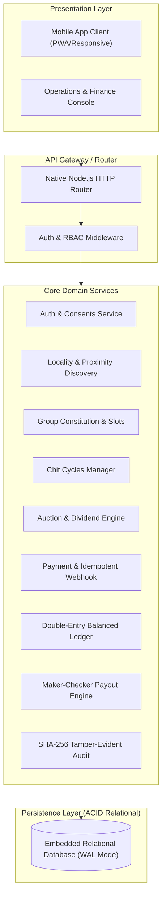
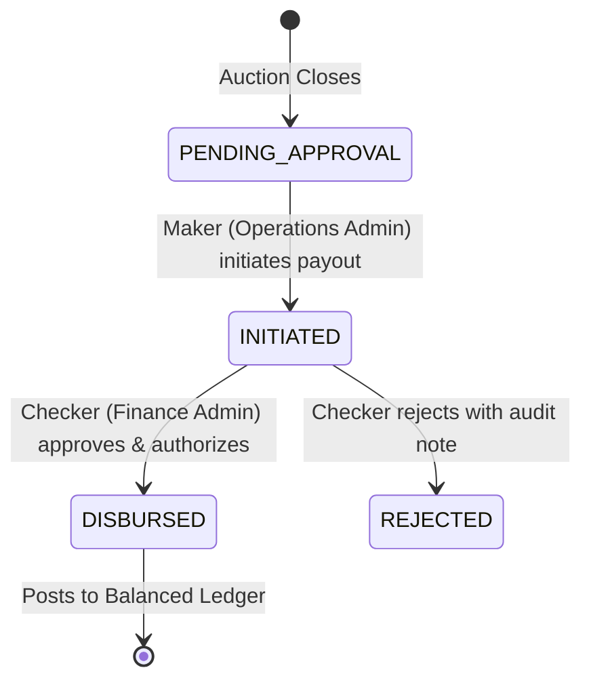

# Technical Architecture Specification: Local Connectivity Chit-Fund Platform

## 1. System Overview

The Local Connectivity Chit-Fund Platform is designed as a modular, domain-driven monolith with strict relational integrity, an immutable append-only ledger, and an embedded event audit system.

---

## 2. Domain Entities & Database Schema

The persistence model separates identity, financial commitments, actual money movement, operational governance, and audit trails into 20 normalized relational tables.

```mermaid
erDiagram
    users ||--o{ user_profiles : "has"
    users ||--o{ user_consents : "signs"
    users ||--o{ kyc_cases : "submits"
    localities ||--o{ chit_groups : "anchors"
    localities ||--o{ user_profiles : "resides_in"
    users ||--o{ chit_groups : "organizes"
    chit_groups ||--o{ group_memberships : "contains"
    users ||--o{ group_memberships : "enrolled_as"
    chit_groups ||--o{ chit_cycles : "schedules"
    chit_cycles ||--o{ contribution_obligations : "generates"
    group_memberships ||--o{ contribution_obligations : "owes"
    contribution_obligations ||--o{ payment_intents : "settled_by"
    chit_cycles ||--o{ bids : "receives"
    group_memberships ||--o{ bids : "places"
    chit_cycles ||--o{ payouts : "awards"
    group_memberships ||--o{ payouts : "benefits"
    chit_groups ||--o{ ledger_transactions : "records"
    ledger_transactions ||--o{ ledger_entries : "contains"
    chart_of_accounts ||--o{ ledger_entries : "classifies"
    users ||--o{ audit_events : "triggers"
```

---

## 3. Double-Entry Accounting Architecture

The platform uses a balanced general ledger model where every monetary transaction contains at least one debit and one credit entry such that:

$$\sum \text{Debit Amounts} - \sum \text{Credit Amounts} = 0$$

All monetary amounts are represented as 64-bit integer minor units (paise: ₹1 = 100 paise) to avoid floating-point rounding errors.

### Chart of Accounts

| Account Code | Account Name | Normal Balance | Classification | Description |
|---|---|---|---|---|
| `1001` | Chit Pool Bank Account | Debit | Asset | Custodial pool bank account holding member contributions |
| `1002` | Member Receivables | Debit | Asset | Outstanding monthly contribution dues owed by members |
| `2001` | Auction Prize Money Payable | Credit | Liability | Net prize fund owed to the winning bidder |
| `2002` | Dividend Equalization Pool | Credit | Liability | Unallocated/distributed dividends awaiting cycle deduction |
| `3001` | Members Capital & Float | Credit | Equity | Total cumulative pool commitment of the chit group |
| `4001` | Organizer Commission Revenue | Credit | Revenue | 5% statutory commission earned by the chit organizer |
| `4002` | Delinquency Penalty Income | Credit | Revenue | Penalties collected on late member payments |

---

## 4. Auction Mechanics & Statutory Mathematical Model

The auction engine strictly implements the statutory provisions of the **Chit Funds Act, 1982 (Act 40 of 1982)**:

1. **Statutory Ceiling (Section 14):**
   $$\text{Max Discount} = 0.30 \times \text{Total Pool}$$
   For a ₹5,00,000 pool, $\text{Max Discount} = \text{₹1,50,000}$.
2. **Statutory Floor:**
   $$\text{Min Discount} = 0.05 \times \text{Total Pool} = \text{Organizer Commission}$$
   For a ₹5,00,000 pool, $\text{Min Discount} = \text{₹25,000}$.
3. **Winner Net Prize Money:**
   $$\text{Prize Money} = \text{Total Pool} - \text{Winning Discount}$$
4. **Member Dividend Allocation:**
   $$\text{Total Dividend} = \text{Winning Discount} - \text{Organizer Commission (5\%)}$$
   $$\text{Dividend Per Member} = \left\lfloor \frac{\text{Total Dividend}}{\text{Total Members}} \right\rfloor$$

---

## 5. Maker-Checker Payout Authorization Lifecycle

To prevent fraud and enforce compliance with internal financial controls, payout disbursement follows a strict separation-of-duties state machine:

**Rule:** `maker_user_id !== checker_user_id`. An administrator cannot approve their own initiated disbursement request.

---

## 6. Tamper-Evident SHA-256 Audit Trail

All sensitive state transitions compute a deterministic SHA-256 hash of the modified object:

$$\text{Hash} = \text{SHA256}(\text{JSON.stringify}(\text{sortedState}))$$

The previous hash, new hash, actor ID, action name, IP address, and UTC timestamp are committed to the `audit_events` table before responding to the client.
